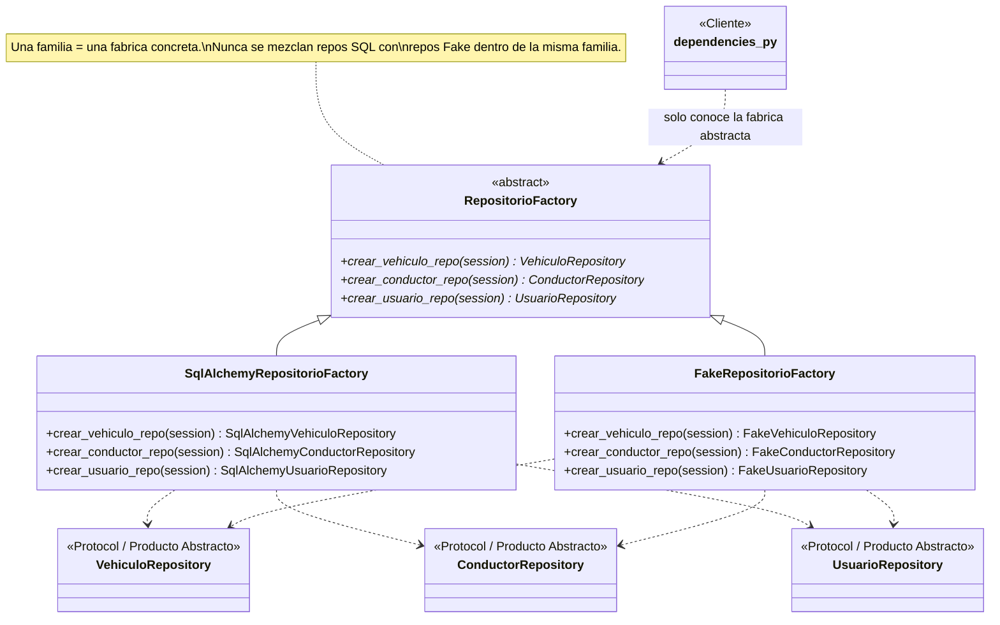

# Abstract Factory

**Fase 3 — patrón #3.** Aplicado a la familia de repositorios de `fleet-management-service` (Vehiculo, Conductor, Usuario).

## 1. Qué es

**Intención (GoF):** producir familias de objetos relacionados sin especificar sus clases concretas, garantizando que los objetos de una misma familia sean compatibles entre sí.

## 2. Por qué aquí

`fleet-management-service` tiene 3 repositorios (Vehiculo, Conductor, Usuario) que, dentro de una misma petición, siempre se usan juntos sobre la **misma sesión/transacción**: son, conceptualmente, "la capa de persistencia de esta petición". Hoy esa familia se ensambla implícitamente — tres funciones sueltas en `dependencies.py`, cada una instanciando su propia clase SQLAlchemy — sin que exista un objeto que represente "la familia completa". Ese es exactamente el problema que resuelve Abstract Factory.

Además, el proyecto **ya tenía**, sin llamarlo así, una segunda familia completa: los repositorios *Fake* en memoria que usan los tests unitarios (`FakeVehiculoRepository`, `FakeConductorRepository`, `FakeUsuarioRepository`). Formalizar esto como Abstract Factory no es un ejercicio artificial — es ponerle nombre a algo que el proyecto ya hacía: elegir entre dos familias de persistencia (real vs. en memoria) según el contexto.

## 3. Diagrama de clases



- **`RepositorioFactory`** — la Fábrica Abstracta. Declara un método de creación por cada repositorio de la familia (`crear_vehiculo_repo`, `crear_conductor_repo`, `crear_usuario_repo`).
- **`VehiculoRepository`, `ConductorRepository`, `UsuarioRepository`** — los Productos Abstractos. No son código nuevo: son los mismos `Protocol` que `application/ports/repositories.py` ya definía para la arquitectura hexagonal — el "puerto" y el "producto abstracto" resultan ser la misma idea vista desde dos patrones distintos.
- **`SqlAlchemyRepositorioFactory`** — Fábrica Concreta #1: familia respaldada por PostgreSQL/SQLAlchemy (uso real).
- **`FakeRepositorioFactory`** — Fábrica Concreta #2: la misma familia, respaldada en memoria (tests unitarios).
- **`dependencies.py`** — el Cliente: solo conoce `RepositorioFactory`, nunca instancia `SqlAlchemyVehiculoRepository` directamente.

## 4. Antes

```python
# app/api/dependencies.py

def get_vehiculo_repo(session: DbSession) -> SqlAlchemyVehiculoRepository:
    return SqlAlchemyVehiculoRepository(session)


def get_conductor_repo(session: DbSession) -> SqlAlchemyConductorRepository:
    return SqlAlchemyConductorRepository(session)


def get_usuario_repo(session: DbSession) -> SqlAlchemyUsuarioRepository:
    return SqlAlchemyUsuarioRepository(session)

VehiculoRepo = Annotated[SqlAlchemyVehiculoRepository, Depends(get_vehiculo_repo)]
ConductorRepo = Annotated[SqlAlchemyConductorRepository, Depends(get_conductor_repo)]
UsuarioRepo = Annotated[SqlAlchemyUsuarioRepository, Depends(get_usuario_repo)]
```

Tres funciones independientes, cada una atada a una clase concreta — nada en el código dice explícitamente que forman una familia.

## 5. Después

```python
# app/infrastructure/db/repositorio_factory.py

class RepositorioFactory(ABC):
    # ============================================================
    # PATRON GOF: ABSTRACT FACTORY -- inicia aqui
    # ============================================================
    @abstractmethod
    def crear_vehiculo_repo(self, session: AsyncSession) -> VehiculoRepository: ...
    @abstractmethod
    def crear_conductor_repo(self, session: AsyncSession) -> ConductorRepository: ...
    @abstractmethod
    def crear_usuario_repo(self, session: AsyncSession) -> UsuarioRepository: ...
    # ================= PATRON GOF: ABSTRACT FACTORY -- termina aqui =================


class SqlAlchemyRepositorioFactory(RepositorioFactory):
    def crear_vehiculo_repo(self, session: AsyncSession) -> VehiculoRepository:
        return SqlAlchemyVehiculoRepository(session)
    def crear_conductor_repo(self, session: AsyncSession) -> ConductorRepository:
        return SqlAlchemyConductorRepository(session)
    def crear_usuario_repo(self, session: AsyncSession) -> UsuarioRepository:
        return SqlAlchemyUsuarioRepository(session)


# app/api/dependencies.py

def get_repositorio_factory() -> RepositorioFactory:
    return SqlAlchemyRepositorioFactory()

RepositorioFactoryDep = Annotated[RepositorioFactory, Depends(get_repositorio_factory)]

def get_vehiculo_repo(session: DbSession, factory: RepositorioFactoryDep) -> VehiculoRepository:
    return factory.crear_vehiculo_repo(session)

def get_conductor_repo(session: DbSession, factory: RepositorioFactoryDep) -> ConductorRepository:
    return factory.crear_conductor_repo(session)

def get_usuario_repo(session: DbSession, factory: RepositorioFactoryDep) -> UsuarioRepository:
    return factory.crear_usuario_repo(session)

VehiculoRepo = Annotated[VehiculoRepository, Depends(get_vehiculo_repo)]
ConductorRepo = Annotated[ConductorRepository, Depends(get_conductor_repo)]
UsuarioRepo = Annotated[UsuarioRepository, Depends(get_usuario_repo)]
```

`dependencies.py` ahora depende de `VehiculoRepository`/`ConductorRepository`/`UsuarioRepository` (los Productos Abstractos), no de las clases SQLAlchemy — igual que ya hacían los casos de uso (`CrearVehiculo(repo: VehiculoRepository)`), así que esto además cierra una pequeña inconsistencia de tipado que ya existía.

## 6. Cómo verificarlo

```python
from app.infrastructure.db.repositorio_factory import RepositorioFactory, SqlAlchemyRepositorioFactory
from tests.unit.fakes import FakeRepositorioFactory

def nombres_de_la_familia(factory: RepositorioFactory, sesion) -> set[str]:
    return {
        type(factory.crear_vehiculo_repo(sesion)).__name__,
        type(factory.crear_conductor_repo(sesion)).__name__,
        type(factory.crear_usuario_repo(sesion)).__name__,
    }

nombres_de_la_familia(SqlAlchemyRepositorioFactory(), object())
# {'SqlAlchemyVehiculoRepository', 'SqlAlchemyConductorRepository', 'SqlAlchemyUsuarioRepository'}

nombres_de_la_familia(FakeRepositorioFactory(), object())
# {'FakeVehiculoRepository', 'FakeConductorRepository', 'FakeUsuarioRepository'}
```

La misma función `nombres_de_la_familia` funciona con cualquiera de las dos fábricas sin cambiar una línea — solo cambia *qué* fábrica se le pasa. Tests dedicados en `tests/unit/test_repositorio_factory.py` (5 casos): la fábrica abstracta no se puede instanciar, cada fábrica concreta arma su familia correctamente, las dos familias nunca se mezclan, y la fábrica Fake reutiliza la misma instancia de cada repositorio entre llamadas (como una sesión real compartida).

| Servicio | Tests |
|---|---|
| fleet-management-service | 53/53 (48 previos + 5 nuevos) |

## 7. De qué manera aporta al proyecto

- **La "familia de persistencia" pasa de ser una convención tácita a un tipo explícito**: antes, que Vehiculo/Conductor/Usuario "van juntos" solo se sabía por leer `dependencies.py`. Ahora `RepositorioFactory` lo declara.
- **Formaliza algo que el proyecto ya hacía con los Fakes**: los tests unitarios siempre usaron una familia alternativa de repositorios en memoria; `FakeRepositorioFactory` simplemente le pone el nombre correcto (y la estructura correcta) a esa práctica.
- **Un solo punto de extensión para una familia futura**: si el día de mañana se agrega, por ejemplo, un modo "solo lectura" o un backend distinto, se agrega una fábrica concreta más — `dependencies.py` no cambia.
- **Reutiliza los puertos hexagonales existentes como Productos Abstractos**: no hubo que inventar interfaces nuevas — los `Protocol` de `application/ports/repositories.py`, que ya existían por la arquitectura hexagonal, resultaron ser exactamente lo que Abstract Factory necesita como "producto abstracto". Buena señal de que la arquitectura de base (Fase 1-2) ya estaba alineada con el patrón antes de nombrarlo.

## 8. Dónde está aplicado

- `services/fleet-management-service/app/infrastructure/db/repositorio_factory.py` (`RepositorioFactory`, `SqlAlchemyRepositorioFactory`)
- `services/fleet-management-service/tests/unit/fakes.py` (`FakeRepositorioFactory`)
- `services/fleet-management-service/app/api/dependencies.py` (Cliente)
