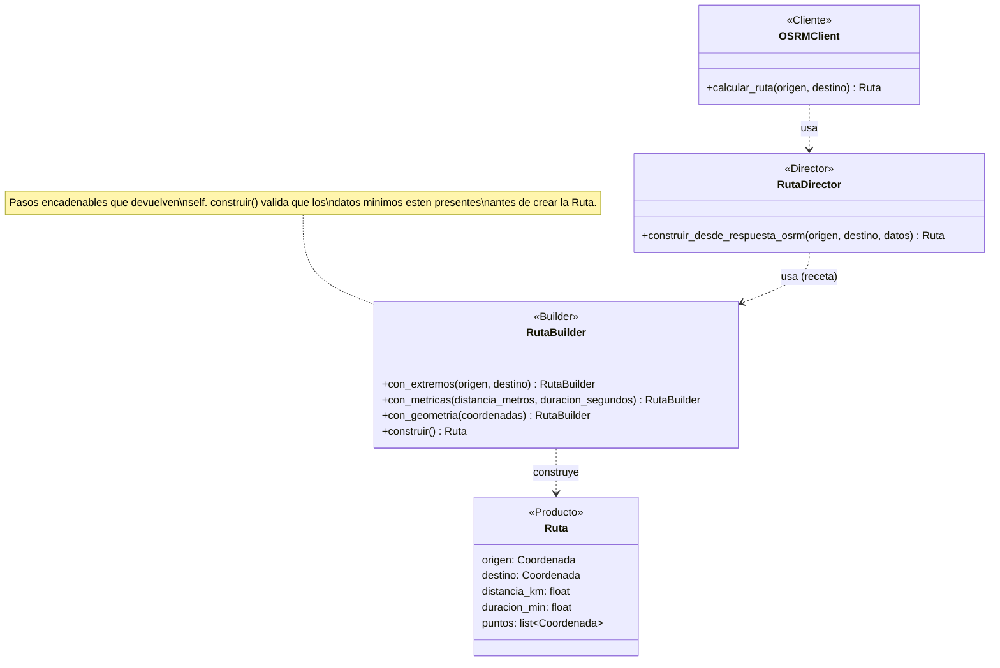

# Builder

**Fase 3 — patrón #4.** Aplicado a la construcción de la entidad `Ruta` en `navigation-integration-service`, a partir de la respuesta cruda del proveedor externo de rutas (OSRM).

## 1. Qué es

**Intención (GoF):** separar la construcción de un objeto complejo de su representación final, de modo que el mismo proceso de construcción — paso a paso, encadenable — pueda ensamblar esa representación a partir de datos crudos de distintas fuentes. Suele apoyarse en un **Director**, que conoce la "receta" (en qué orden invocar los pasos) para una fuente de datos concreta, sin tener que repetir esa lógica en el objeto que solo necesita el resultado final.

## 2. Por qué aquí

`navigation-integration-service` tiene una única entidad de dominio no trivial, `Ruta`, con 5 campos — dos de ellos, `distancia_km` y `duracion_min`, requieren convertir unidades (metros/segundos → km/minutos), y un tercero, `puntos`, requiere parsear una lista anidada de coordenadas GeoJSON. Antes de aplicar el patrón, todo esto vivía mezclado dentro de `OSRMClient.calcular_ruta`: el mismo método que hace la petición HTTP, valida el status code y maneja errores del proveedor, también hacía la conversión de unidades y el parseo de geometría en línea, justo antes de construir el objeto `Ruta` con un constructor de 5 argumentos.

Ese es exactamente el síntoma que Builder resuelve: un objeto que se ensambla combinando varias piezas (parámetros propios + campos derivados con matemática + una colección transformada desde una estructura anidada) dentro del mismo método que hace otra cosa (la llamada HTTP). Se separó en dos piezas nuevas:

- **`RutaBuilder`** — el Builder: sabe *cómo* ensamblar una `Ruta` paso a paso (fijar extremos, fijar métricas ya convertidas, fijar geometría ya parseada), pero no sabe nada de OSRM. Vive en `app/domain/` porque solo conoce tipos de dominio.
- **`RutaDirector`** — el Director: sabe *la receta exacta* para una fuente concreta — la forma del JSON de OSRM (`distance`, `duration`, `geometry.coordinates`) — y en qué orden llamar al builder para traducirla. Vive en `app/infrastructure/external/` porque conocer la forma de la respuesta de OSRM es conocimiento de infraestructura, no de dominio (regla de dependencia hexagonal).

Con esto, `OSRMClient.calcular_ruta` queda enfocado únicamente en su responsabilidad real — hablar HTTP con OSRM y traducir sus errores — y delega el ensamblado del objeto final en una sola línea.

## 3. Diagrama de clases



- **`Ruta`** — el **Producto**: la entidad de dominio final que se está construyendo.
- **`RutaBuilder`** — el **Builder** concreto. Expone pasos encadenables (`con_extremos`, `con_metricas`, `con_geometria`) que devuelven `self`, y un método final `construir()` que valida que los datos mínimos estén presentes y devuelve la `Ruta`.
- **`RutaDirector`** — el **Director**. Conoce la receta para una fuente de datos concreta (`construir_desde_respuesta_osrm`) y orquesta las llamadas al builder en el orden correcto.
- **`OSRMClient`** — el **Cliente**. Usa al Director sin conocer los pasos internos del builder ni las conversiones de unidades.

No existe una interfaz `Builder` abstracta separada de `RutaBuilder`: hoy solo hay una forma de representar una `Ruta`, así que una única clase concreta es suficiente — igual que Factory Method y Abstract Factory, el patrón se aplicó a la necesidad real del proyecto, no a una hipotética generalización futura. Si mañana se agrega un segundo proveedor de rutas con una respuesta distinta, se agrega un método nuevo en `RutaDirector` (por ejemplo `construir_desde_respuesta_google`) que reutiliza el mismo `RutaBuilder` — sin duplicar la lógica de conversión de unidades ni de parseo de geometría.

## 4. Antes

```python
# app/infrastructure/external/osrm_client.py

async def calcular_ruta(self, origen: Coordenada, destino: Coordenada) -> Ruta:
    # ... peticion HTTP, manejo de errores ...

    ruta_osrm = datos["routes"][0]
    puntos = [
        Coordenada(latitud=lat, longitud=lon)
        for lon, lat in ruta_osrm["geometry"]["coordinates"]
    ]

    return Ruta(
        origen=origen,
        destino=destino,
        distancia_km=ruta_osrm["distance"] / 1000,
        duracion_min=ruta_osrm["duration"] / 60,
        puntos=puntos,
    )
```

La conversión de unidades, el parseo de geometría y el ensamblado final del objeto están mezclados dentro del método que hace la llamada HTTP.

## 5. Después

```python
# app/domain/ruta_builder.py

class RutaBuilder:
    def __init__(self) -> None:
        self._origen: Coordenada | None = None
        self._destino: Coordenada | None = None
        self._distancia_km: float | None = None
        self._duracion_min: float | None = None
        self._puntos: list[Coordenada] = []

    def con_extremos(self, origen: Coordenada, destino: Coordenada) -> RutaBuilder:
        self._origen = origen
        self._destino = destino
        return self

    def con_metricas(self, *, distancia_metros: float, duracion_segundos: float) -> RutaBuilder:
        self._distancia_km = distancia_metros / 1000
        self._duracion_min = duracion_segundos / 60
        return self

    def con_geometria(self, coordenadas_lon_lat: list[tuple[float, float]]) -> RutaBuilder:
        self._puntos = [
            Coordenada(latitud=lat, longitud=lon) for lon, lat in coordenadas_lon_lat
        ]
        return self

    def construir(self) -> Ruta:
        if self._origen is None or self._destino is None:
            raise ValueError("RutaBuilder: faltan los extremos antes de construir()")
        if self._distancia_km is None or self._duracion_min is None:
            raise ValueError("RutaBuilder: faltan las metricas antes de construir()")
        return Ruta(
            origen=self._origen, destino=self._destino,
            distancia_km=self._distancia_km, duracion_min=self._duracion_min,
            puntos=self._puntos,
        )


# app/infrastructure/external/ruta_director.py

class RutaDirector:
    def construir_desde_respuesta_osrm(self, origen, destino, ruta_osrm: dict) -> Ruta:
        return (
            RutaBuilder()
            .con_extremos(origen, destino)
            .con_metricas(
                distancia_metros=ruta_osrm["distance"],
                duracion_segundos=ruta_osrm["duration"],
            )
            .con_geometria(ruta_osrm["geometry"]["coordinates"])
            .construir()
        )


# app/infrastructure/external/osrm_client.py

async def calcular_ruta(self, origen: Coordenada, destino: Coordenada) -> Ruta:
    # ... peticion HTTP, manejo de errores (sin cambios) ...

    ruta_osrm = datos["routes"][0]
    return self._director.construir_desde_respuesta_osrm(origen, destino, ruta_osrm)
```

`calcular_ruta` queda con una sola responsabilidad: hablar con OSRM por HTTP y traducir sus errores a excepciones de dominio. El ensamblado del objeto final es ahora una sola línea, delegada por completo.

## 6. Cómo verificarlo

```python
from app.domain.ruta_builder import RutaBuilder
from app.infrastructure.external.ruta_director import RutaDirector

ruta = (
    RutaBuilder()
    .con_extremos(origen, destino)
    .con_metricas(distancia_metros=415000.0, duracion_segundos=18000.0)
    .con_geometria([(-74.07, 4.71), (-75.56, 6.25)])
    .construir()
)
# ruta.distancia_km == 415.0, ruta.duracion_min == 300.0

ruta = RutaDirector().construir_desde_respuesta_osrm(origen, destino, ruta_osrm_json)
# mismo resultado, pero a partir de la forma cruda de la respuesta de OSRM
```

Tests nuevos: `tests/unit/test_ruta_builder.py` (5 casos — ensamblado completo, geometría opcional por defecto vacía, encadenado fluido, y los dos `ValueError` cuando falta un paso obligatorio) y `tests/unit/test_ruta_director.py` (2 casos — traducción completa desde un JSON de OSRM, y el caso sin puntos intermedios). Los 4 tests preexistentes de `test_osrm_client.py` — que verifican `calcular_ruta` de punta a punta contra un servidor HTTP simulado — siguieron pasando sin ningún cambio, confirmando que el refactor no alteró el comportamiento observable del cliente.

| Servicio | Tests |
|---|---|
| navigation-integration-service | 25/25 (18 previos + 7 nuevos) |

## 7. De qué manera aporta al proyecto

- **Separa dos responsabilidades que vivían mezcladas**: `OSRMClient.calcular_ruta` ahora solo hace HTTP; la conversión de unidades y el parseo de geometría tienen su propio lugar, testeable de forma aislada sin levantar ningún cliente HTTP.
- **Respeta la regla de dependencia hexagonal**: `RutaBuilder` (dominio) no sabe qué es OSRM; `RutaDirector` (infraestructura) es el único que conoce la forma exacta del JSON externo. Antes, ese conocimiento externo vivía sin frontera clara dentro del mismo método que hacía la petición.
- **Punto único de extensión para un futuro segundo proveedor**: agregar Google Directions o Mapbox como alternativa a OSRM solo requeriría un nuevo método en `RutaDirector` — la lógica de conversión de unidades y parseo de geometría en `RutaBuilder` se reutiliza tal cual.
- **La interfaz fluida documenta el orden de ensamblado**: `con_extremos().con_metricas().con_geometria().construir()` deja explícito, con el propio código, qué información necesita una `Ruta` para existir — algo que antes solo se sabía leyendo los 5 argumentos posicionales del constructor.

## 8. Dónde está aplicado

- `services/navigation-integration-service/app/domain/ruta_builder.py` (`RutaBuilder`)
- `services/navigation-integration-service/app/infrastructure/external/ruta_director.py` (`RutaDirector`)
- `services/navigation-integration-service/app/infrastructure/external/osrm_client.py` (Cliente)
- `services/navigation-integration-service/tests/unit/test_ruta_builder.py`
- `services/navigation-integration-service/tests/unit/test_ruta_director.py`
