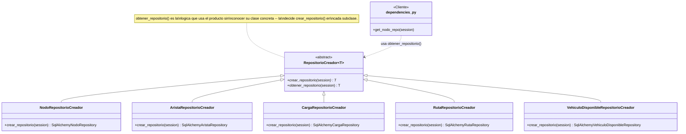

# Factory Method

**Fase 3 — patrón #2.** Aplicado a la creación de los 5 repositorios de `route-optimization-service` (Nodo, Arista, Carga, Ruta, VehiculoDisponible).

## 1. Qué es

**Intención (GoF):** proporcionar una interfaz para crear un objeto en una superclase, dejando que las subclases decidan qué clase concreta instanciar.

## 2. Por qué aquí

`route-optimization-service` es el servicio con más entidades propias del proyecto (5, frente a las 2-3 del resto). Antes, cada una tenía su propia función suelta en `dependencies.py` (`get_nodo_repo`, `get_arista_repo`, etc.) que simplemente hacía `return SqlAlchemyXxxRepository(session)` — cinco funciones casi idénticas, sin ninguna relación explícita entre ellas más que la copia-pega. Factory Method formaliza exactamente ese patrón repetido: una Creadora abstracta declara *que* hay que fabricar un repositorio, y una Creadora concreta por entidad decide *cuál*.

## 3. Diagrama de clases



- **`RepositorioCreador`** — la Creadora abstracta. Declara el método fábrica `crear_repositorio()` (abstracto) y ofrece `obtener_repositorio()`, que lo usa sin saber qué clase concreta va a recibir.
- **`crear_repositorio()`** — el método fábrica. Cada Creadora concreta lo sobreescribe para instanciar su propio repositorio.
- **`NodoRepositorioCreador`, `AristaRepositorioCreador`, `CargaRepositorioCreador`, `RutaRepositorioCreador`, `VehiculoDisponibleRepositorioCreador`** — las Creadoras concretas, una por entidad. Viven junto a su repositorio (en el mismo archivo), no en un archivo aparte.
- **`dependencies.py`** — el Cliente: llama a `obtener_repositorio()` a través de la Creadora concreta que le corresponde a cada entidad, sin instanciar `SqlAlchemyXxxRepository` directamente.

## 4. Antes

```python
# app/api/dependencies.py

def get_nodo_repo(session: DbSession) -> SqlAlchemyNodoRepository:
    return SqlAlchemyNodoRepository(session)


def get_arista_repo(session: DbSession) -> SqlAlchemyAristaRepository:
    return SqlAlchemyAristaRepository(session)

# ...y asi 3 veces mas (Carga, Ruta, VehiculoDisponible), cada una
# instanciando su propia clase directamente.
```

## 5. Después

```python
# app/infrastructure/db/repositorio_creador.py

class RepositorioCreador(ABC, Generic[T]):
    # ============================================================
    # PATRON GOF: FACTORY METHOD -- inicia aqui
    # ============================================================
    @abstractmethod
    def crear_repositorio(self, session: AsyncSession) -> T:
        ...

    def obtener_repositorio(self, session: AsyncSession) -> T:
        return self.crear_repositorio(session)
    # ================= PATRON GOF: FACTORY METHOD -- termina aqui =================


# app/infrastructure/db/nodo_repository.py (al final del archivo)

class NodoRepositorioCreador(RepositorioCreador[SqlAlchemyNodoRepository]):
    def crear_repositorio(self, session: AsyncSession) -> SqlAlchemyNodoRepository:
        return SqlAlchemyNodoRepository(session)


# app/api/dependencies.py

def get_nodo_repo(session: DbSession) -> SqlAlchemyNodoRepository:
    return NodoRepositorioCreador().obtener_repositorio(session)
```

Las otras 4 entidades (Arista, Carga, Ruta, VehiculoDisponible) siguen exactamente el mismo molde: una Creadora concreta al final de su archivo de repositorio, y `dependencies.py` la usa en vez de instanciar directo.

## 6. Cómo verificarlo

```python
from app.infrastructure.db.repositorio_creador import RepositorioCreador
from app.infrastructure.db.nodo_repository import NodoRepositorioCreador
from app.infrastructure.db.arista_repository import AristaRepositorioCreador

# La Creadora abstracta no se puede instanciar directamente:
RepositorioCreador()  # TypeError: Can't instantiate abstract class...

# Cada Creadora concreta fabrica su propio tipo, pero el codigo que
# las usa (obtener_repositorio) es identico para todas:
creadoras = [NodoRepositorioCreador(), AristaRepositorioCreador()]
for c in creadoras:
    print(type(c.obtener_repositorio(session=object())).__name__)
# SqlAlchemyNodoRepository
# SqlAlchemyAristaRepository
```

Tests dedicados en `tests/unit/test_repositorio_creador.py` (7 casos): la Creadora abstracta no se puede instanciar, cada Creadora concreta fabrica el repositorio correcto, y una prueba de uso polimórfico que recorre las 5 Creadoras a través del tipo base sin conocer sus clases concretas.

| Servicio | Tests |
|---|---|
| route-optimization-service | 35/35 (28 previos + 7 nuevos) |

## 7. De qué manera aporta al proyecto

- **Cinco funciones casi-copiadas se vuelven cinco clases con una forma explícita en común**: antes, la única señal de que `get_nodo_repo`/`get_arista_repo`/etc. seguían "el mismo patrón" era leer el código y notar que se parecían. Ahora esa relación existe en el tipo (`RepositorioCreador[T]`), no solo en la convención.
- **Punto único para lógica futura de creación**: si más adelante se necesita algo al construir cualquier repositorio (logging, métricas, caché), `obtener_repositorio()` es el único lugar donde agregarlo — hoy afecta a los 5 repositorios a la vez, sin tocar `dependencies.py`.
- **Ejercicio limpio de subclases + polimorfismo**: a diferencia de Singleton (que reforzó algo que ya existía de facto), este es un caso donde el mecanismo del patrón se ve trabajar de verdad — 5 subclases distintas, un único punto de acceso (`obtener_repositorio`) que no sabe cuál está usando.

## 8. Dónde está aplicado

- `services/route-optimization-service/app/infrastructure/db/repositorio_creador.py` (la Creadora abstracta)
- `services/route-optimization-service/app/infrastructure/db/nodo_repository.py` (`NodoRepositorioCreador`)
- `services/route-optimization-service/app/infrastructure/db/arista_repository.py` (`AristaRepositorioCreador`)
- `services/route-optimization-service/app/infrastructure/db/carga_repository.py` (`CargaRepositorioCreador`)
- `services/route-optimization-service/app/infrastructure/db/ruta_repository.py` (`RutaRepositorioCreador`)
- `services/route-optimization-service/app/infrastructure/db/vehiculo_disponible_repository.py` (`VehiculoDisponibleRepositorioCreador`)
- `services/route-optimization-service/app/api/dependencies.py` (Cliente)
