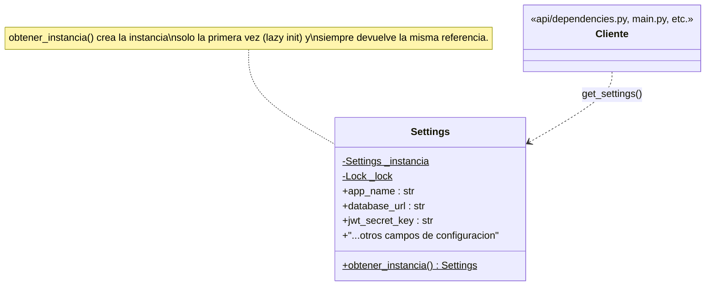

# Singleton

**Fase 3 — patrón #1.** Aplicado a la clase `Settings` (configuración por variables de entorno) en los 6 microservicios.

## 1. Qué es

**Intención (GoF):** garantizar que una clase tenga una única instancia y proporcionar un punto de acceso global a ella.

## 2. Por qué aquí

Cada microservicio lee su configuración (`DATABASE_URL`, `RABBITMQ_URL`, `JWT_SECRET_KEY`, etc.) desde `.env` a través de una clase `Settings`. Repartir esa lectura en instancias distintas por cada llamada no tiene sentido: la configuración de un proceso no cambia mientras corre, así que crearla una sola vez y reutilizarla es exactamente el problema que Singleton resuelve. Además, las 6 clases `Settings` del proyecto (una por servicio) ya compartían el mismo problema y la misma solución de facto (ver sección "Antes"), lo que las convierte en el punto de entrada más natural para el primer patrón de la Fase 3.

## 3. Diagrama de clases



- **`Settings`** — la clase Singleton. Hereda de `pydantic_settings.BaseSettings`, así que además de implementar el patrón sigue siendo la clase de datos que valida y parsea las variables de entorno.
- **`_instancia`** — campo estático privado, la única instancia (empieza en `None`).
- **`_lock`** — candado (`threading.Lock`) para que la creación sea segura si dos hilos piden la instancia al mismo tiempo antes de que exista.
- **`obtener_instancia()`** — método estático, el punto de acceso global. Crea la instancia la primera vez y siempre devuelve esa misma referencia después.
- **`Cliente`** — cualquier módulo del servicio (`api/dependencies.py`, `main.py`, repositorios, etc.) que necesita la configuración. Nunca llama a `Settings()` directamente ni conoce `_instancia`/`_lock`; solo usa la función `get_settings()`.

## 4. Antes

Los 6 servicios resolvían "una sola instancia" apoyándose en un detalle de una librería externa (`functools.lru_cache`), no en una decisión de diseño explícita en la propia clase:

```python
from functools import lru_cache
from pydantic_settings import BaseSettings, SettingsConfigDict


class Settings(BaseSettings):
    model_config = SettingsConfigDict(env_file=".env", env_file_encoding="utf-8")

    app_name: str = "fleet-management-service"
    # ...resto de campos...


@lru_cache
def get_settings() -> Settings:
    return Settings()
```

Funcionaba (`lru_cache` memoriza el resultado de la primera llamada), pero el "singleton-ness" no era visible como tal: alguien podía instanciar `Settings()` directamente en cualquier parte del código y nada lo impedía ni lo señalaba como un error de diseño.

## 5. Después

```python
class Settings(BaseSettings):
    model_config = SettingsConfigDict(env_file=".env", env_file_encoding="utf-8")

    app_name: str = "fleet-management-service"
    # ...resto de campos...

    # ============================================================
    # PATRON GOF: SINGLETON -- inicia aqui
    # ============================================================
    _instancia: ClassVar[Settings | None] = None
    _lock: ClassVar[threading.Lock] = threading.Lock()

    @classmethod
    def obtener_instancia(cls) -> Settings:
        if cls._instancia is None:
            with cls._lock:
                if cls._instancia is None:
                    cls._instancia = cls()
        return cls._instancia
    # ================= PATRON GOF: SINGLETON -- termina aqui =================


def get_settings() -> Settings:
    return Settings.obtener_instancia()
```

`get_settings()` se conserva a propósito: es el nombre que ya usaba todo el proyecto (`api/dependencies.py`, `main.py`, scripts de seed, etc.), así que ningún otro archivo tuvo que cambiar — ahora es un wrapper delgado que delega en el Singleton.

**Nota sobre el "constructor privado" del patrón clásico:** en el pseudocódigo de referencia, el constructor de `Database` es privado para impedir `new Database()` desde fuera. En Python eso no se puede imponer al 100 % cuando la clase hereda de `pydantic.BaseModel`/`BaseSettings`, porque pydantic necesita poder invocar `__init__` internamente (validación, copias, etc.). Por eso la regla se documenta y se respeta **por convención**: todo el código debe pasar por `obtener_instancia()` / `get_settings()`, nunca instanciar `Settings()` directo. Se verificó que en los 6 servicios `Settings()` solo se llama una vez, dentro de `obtener_instancia()`.

## 6. Cómo verificarlo

```python
from app.core.config import get_settings, Settings

a = get_settings()
b = get_settings()
c = Settings.obtener_instancia()

print(a is b)  # True
print(a is c)  # True
```

Salida real (`fleet-management-service`):

```
a is b: True
a is c: True
id(a): 2039974416048
id(b): 2039974416048
```

Y los tests existentes de los 6 servicios (que no tocan `get_settings()` a propósito, para no acoplarse a un detalle de implementación) siguen pasando exactamente igual que antes del cambio:

| Servicio | Tests |
|---|---|
| fleet-management-service | 48/48 |
| api-gateway | 30/30 |
| vehicle-tracking-service | 21/21 |
| route-optimization-service | 28/28 |
| predictive-maintenance-service | 24/24 |
| navigation-integration-service | 18/18 |

## 7. De qué manera aporta al proyecto

- **Consistencia de configuración**: garantiza que toda la app lea `.env` una sola vez por proceso; si algo llegara a instanciar `Settings()` fuera de `obtener_instancia()`, tendría una config "huérfana" fácil de detectar en revisión de código porque rompe la convención documentada.
- **La garantía deja de ser implícita**: antes dependía de que nadie quitara el decorador `@lru_cache` por accidente; ahora es una responsabilidad explícita de la propia clase, con nombre y estructura reconocibles.
- **Un solo punto de extensión**: si más adelante se necesita lógica extra al crear la configuración (loguear qué variables se cargaron, validar coherencia entre campos, etc.), hay un único lugar (`obtener_instancia()`) donde añadirla, en vez de seis funciones `get_settings()` idénticas.
- **Punto de partida para la Fase 3**: al ser el primer patrón GoF nombrado explícitamente en el código, fija la convención (banner de comentarios `PATRON GOF: <nombre> -- inicia/termina aqui` + este documento) que se va a repetir para cada patrón siguiente.

## 8. Dónde está aplicado

- `services/fleet-management-service/app/core/config.py`
- `services/api-gateway/app/core/config.py`
- `services/vehicle-tracking-service/app/core/config.py`
- `services/route-optimization-service/app/core/config.py`
- `services/predictive-maintenance-service/app/core/config.py`
- `services/navigation-integration-service/app/core/config.py`
